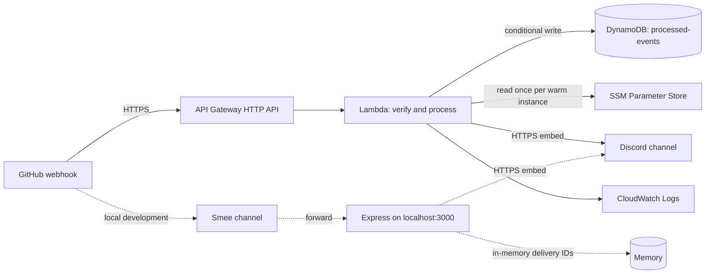

# Webhook Bridge

Webhook Bridge turns GitHub repository events into Discord alerts. It verifies that a request was signed with the shared webhook secret, avoids processing the same delivery twice, and sends an embed for events we care about. This makes a failed deployment visible in a Discord channel without requiring someone to watch GitHub Actions.

## Events

| GitHub event | Condition | Discord embed |
| --- | --- | --- |
| `workflow_run` | `action` is `completed`, conclusion is `failure` | Red **Deploy failed**, linked to the run |
| `workflow_run` | `action` is `completed`, conclusion is `success` | Green **Deploy passed**, linked to the run |
| `push` | `ref` is `refs/heads/main` | Blue **New push**, with the comparison link when provided |
| `ping` or any other event | — | No alert; a valid delivery is acknowledged |

The `workflow_run` mapping applies to all completed workflows in the connected repository, not only a workflow named “Simulated deploy.” The handler requires the `x-github-delivery` header even for ignored events.

## Architecture



The deployed project uses **API Gateway HTTP API → Lambda** in `il-central-1` (Tel Aviv). The local route is `POST /webhooks/github`, with `GET /health` for a basic health check. A GitHub webhook has one destination: changing its payload URL from Smee to API Gateway switches that webhook to AWS; switch it back for local testing or use a separate webhook.

For every request, the local server and Lambda compute an HMAC-SHA256 over the **original body bytes** and compare it with `x-hub-signature-256` using a timing-safe comparison. A missing or invalid signature receives `401`. After verification, the delivery ID from `x-github-delivery` provides the idempotency key.

Locally, delivery IDs are kept in memory and are lost on restart. On AWS, a conditional `PutItem` into `processed-events` makes the check atomic across Lambda instances. Items have an `expiresAt` timestamp 30 days after insertion. [DynamoDB TTL deletion is asynchronous](https://docs.aws.amazon.com/amazondynamodb/latest/developerguide/TTL.html), so an expired ID can remain a duplicate until DynamoDB deletes it.

**Delivery limitation:** the Lambda records an ID *before* posting to Discord. If the Discord post fails or Lambda times out after that write, redelivery of the same ID is treated as a duplicate and will not retry the alert. Also, a timeout after Discord accepts a request can make delivery status ambiguous; retries are not a guarantee of exactly-once posting. The local store marks an ID complete only after successful processing.

## Prerequisites

- Node.js 22.12 or later within the Node 22 release line, npm, and the `zip` command.
- A GitHub repository with a webhook and a Discord channel with an incoming webhook.
- A Smee channel for local testing, or an AWS account for the deployed route.

## Local setup

1. Clone this repository and enter its directory.
2. Install the locked dependencies and create your local configuration:

   ```sh
   npm ci
   cp .env.example .env
   ```

3. Edit `.env` locally. Set `GITHUB_WEBHOOK_SECRET` to the same secret configured in GitHub and `DISCORD_WEBHOOK_URL` to the incoming webhook URL for your Discord channel. Do not commit or share these values. `.env` is ignored by Git.
4. Start the server:

   ```sh
   npm run dev
   ```

5. In a second terminal, forward your Smee channel to the local route:

   ```sh
   npx smee --url https://smee.io/YOUR_CHANNEL --path /webhooks/github --port 3000
   ```

6. In the GitHub repository, open **Settings → Webhooks**, add or edit the webhook, and set its payload URL to the Smee channel. Choose **application/json**, set the matching secret, select **Pushes** and **Workflow runs**, and leave the webhook active.
7. Visit `http://localhost:3000/health`; it should return `{"status":"ok"}`.

Smee forwards deliveries only while the client is connected. Avoid putting secrets in webhook payloads: anyone with the Smee channel URL may be able to view forwarded events.

## Configuration

| Setting | Purpose |
| --- | --- |
| `GITHUB_WEBHOOK_SECRET` | Shared GitHub signing secret for the local server |
| `DISCORD_WEBHOOK_URL` | Discord incoming webhook URL for the local server |
| `/webhook-bridge/github-webhook-secret` | AWS SSM `SecureString` containing the signing secret |
| `/webhook-bridge/discord-webhook-url` | AWS SSM `SecureString` containing the Discord webhook URL |

The local development command loads `.env` using Node's `--env-file-if-exists`. Lambda reads both SSM parameters with decryption and caches them for each warm execution environment. Updating a parameter does not immediately refresh an already-warm instance; update the Lambda configuration or deploy a new version to replace warm instances.

## AWS deployment

The deployed architecture uses an API Gateway HTTP API Lambda integration with payload format `2.0`, Lambda Node.js 22, DynamoDB, SSM Parameter Store, and CloudWatch Logs. [AWS documents the HTTP API event format](https://docs.aws.amazon.com/apigateway/latest/developerguide/http-api-develop-integrations-lambda.html), including lowercase header names and `isBase64Encoded`.

1. In **Israel (Tel Aviv), `il-central-1`**, create the DynamoDB table `processed-events` with a String partition key `eventId`. Enable TTL on `expiresAt`.
2. In the same Region, create the two parameters listed above as SSM **Standard SecureString** values. Use the same GitHub secret as the webhook; use the Discord incoming webhook URL as the second value.
3. Create a Lambda function named `webhook-bridge`, using Node.js 22 and an execution role with CloudWatch logging permissions. Set the timeout to **8 seconds**.
4. Add an execution-role policy that permits `dynamodb:PutItem` on the `processed-events` table and `ssm:GetParameters` on the two exact parameter ARNs. With a customer-managed KMS key, grant its required `kms:Decrypt` permission as well. The existing setup uses the default AWS-managed SSM key.
5. Build the deployment archive:

   ```sh
   npm run build
   ```

   The build type-checks TypeScript, bundles `src/lambda.ts` and its dependencies into `dist/lambda.cjs`, and packages it as `dist/webhook-bridge.zip`. In Lambda, choose **Code → Update → Update from a .zip file**, upload the ZIP, and set **Runtime settings → Handler** to `lambda.handler`. The `.cjs` bundle is CommonJS; the project source remains ES modules.
6. Create an **HTTP API** in API Gateway with a Lambda integration targeting this function. Use payload format `2.0`, a deployed stage, and an unauthenticated route so GitHub can reach it. The existing deployment uses the `default` stage and `/webhook-bridge` path. Configure GitHub's payload URL to the resulting API endpoint, with the same secret, `application/json`, and the **Pushes** and **Workflow runs** events.
7. Check **CloudWatch → Log groups → `/aws/lambda/webhook-bridge`** for one application JSON log per delivery. The fields are `deliveryId`, `event`, `action`, `outcome`, and `durationMs`; outcomes are `alerted`, `duplicate`, `ignored`, `rejected`, or `error`. Lambda's platform logs appear separately.

The API endpoint is publicly reachable and can incur AWS usage charges. Signature verification rejects unauthenticated payloads, but it happens after the request reaches Lambda.

## Testing

Run the automated tests and build:

```sh
npm test
npm run build
```

The tests cover signature verification, event mapping, Discord retries, local duplicate handling, Lambda event decoding, conditional DynamoDB writes, and SSM caching. AWS calls are mocked in the automated tests.

To test a signed local ping and a tampered body, start `npm run dev`, then run this from the project directory. It prints status codes, not the secret:

```sh
node --env-file=.env --input-type=module <<'NODE'
import { createHmac, randomUUID } from 'node:crypto';

const body = Buffer.from('{"test":true}');
const signature = 'sha256=' + createHmac('sha256', process.env.GITHUB_WEBHOOK_SECRET)
  .update(body).digest('hex');
const headers = {
  'content-type': 'application/json',
  'x-github-event': 'ping',
  'x-github-delivery': randomUUID(),
  'x-hub-signature-256': signature,
};
const url = 'http://localhost:3000/webhooks/github';
const valid = await fetch(url, { method: 'POST', headers, body });
const tampered = await fetch(url, { method: 'POST', headers, body: '{"test":false}' });
console.log('Valid ping:', valid.status);       // 200; no Discord alert
console.log('Tampered body:', tampered.status); // 401; no Discord alert
NODE
```

For an end-to-end test, in `bridge-playground` choose **Actions → Simulated deploy → Run workflow**, select `fail`, and run it. The workflow should fail intentionally and a red alert should appear in Discord. Select `pass` for a green alert. Open the webhook's **Recent Deliveries** in GitHub to inspect the HTTP response, and check the relevant local or CloudWatch log for the outcome. Redeliver the completed event to test duplicate handling; it should receive `200` without a second alert, provided the ID is still recorded in the active store.

## Troubleshooting

- **Signature mismatch (`401`):** Verify the GitHub webhook secret exactly matches the local `.env` value or the SSM parameter used by Lambda. Do not print either value. Check that GitHub sends `application/json` and that no proxy modifies the body.
- **Raw body:** HMAC verification must use the original bytes. The local route uses `express.raw`, not `express.json`; the Lambda decodes `body` from base64 when `isBase64Encoded` is true. Re-serializing parsed JSON before verification can change whitespace or byte order and break the signature.
- **Missing delivery ID or invalid JSON (`400`):** Send GitHub's `x-github-delivery` header and a valid JSON body. A signature is checked before the body is parsed.
- **Timeouts or slow delivery:** GitHub expects a 2xx response within 10 seconds. Lambda is configured for 8 seconds; SSM and DynamoDB calls have short timeouts, and Discord has at most two retries with short backoff and jitter. Investigate CloudWatch duration and service connectivity. [GitHub's webhook guidance](https://docs.github.com/en/webhooks/using-webhooks/best-practices-for-using-webhooks) explains the response deadline.
- **Discord error (`502`):** Check that the webhook URL is valid and points to the intended channel. The sender retries network failures, server errors, and some rate limits; it stops rather than retrying before a positive `Retry-After`. On AWS, remember the ID was already recorded before the failed send, so redelivering it will be skipped.
- **Duplicates or missing alerts:** Look for `outcome` and `deliveryId` in the logs. Local IDs disappear when the server restarts. AWS IDs persist in DynamoDB until TTL deletes them, which can take longer than 30 days. Different delivery IDs for separate events or workflows are not duplicates. A timed-out Discord request can also leave its delivery status uncertain.
- **GitHub does not automatically retry failed webhook deliveries:** In the repository, open **Settings → Webhooks**, select the webhook, then **Recent Deliveries**. Open the delivery, choose **Redeliver**, and confirm. GitHub keeps the same delivery ID on redelivery, so a previously processed delivery should be skipped. [GitHub's redelivery instructions](https://docs.github.com/en/webhooks/testing-and-troubleshooting-webhooks/redelivering-webhooks).
- **No delivery reaches local development:** Check that `npm run dev` and the Smee client are both running, the Smee URL matches the GitHub payload URL, and the forwarder targets `/webhooks/github` on port 3000. A webhook pointed at API Gateway sends to AWS instead.
- **AWS `500` or no log:** Check that both SSM parameters and the DynamoDB table are in `il-central-1`, the Lambda execution role has the required permissions, the handler is `lambda.handler`, and the HTTP API route invokes the correct function. Review CloudWatch Logs and GitHub's delivery response without sharing secrets.
